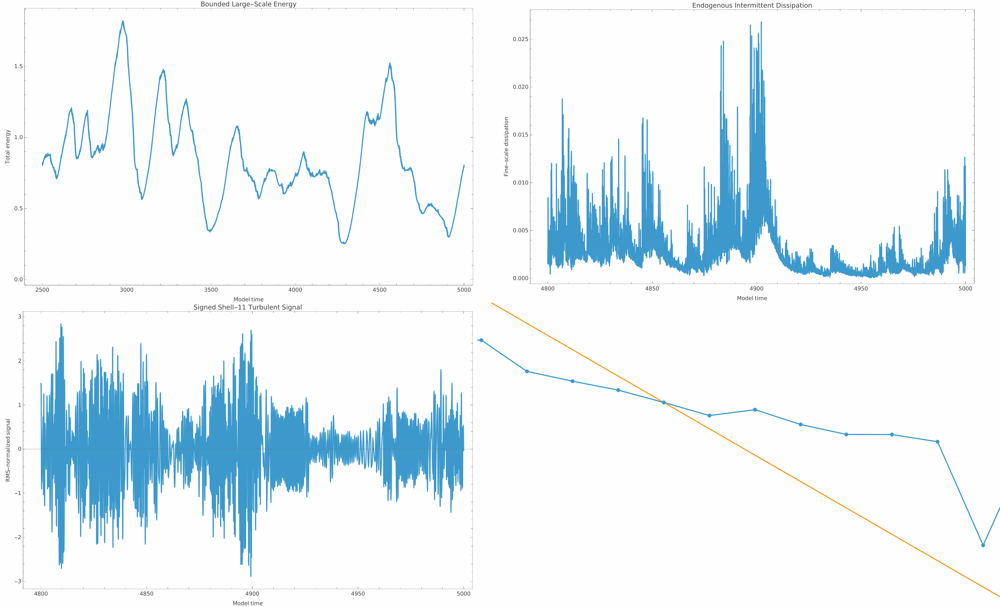
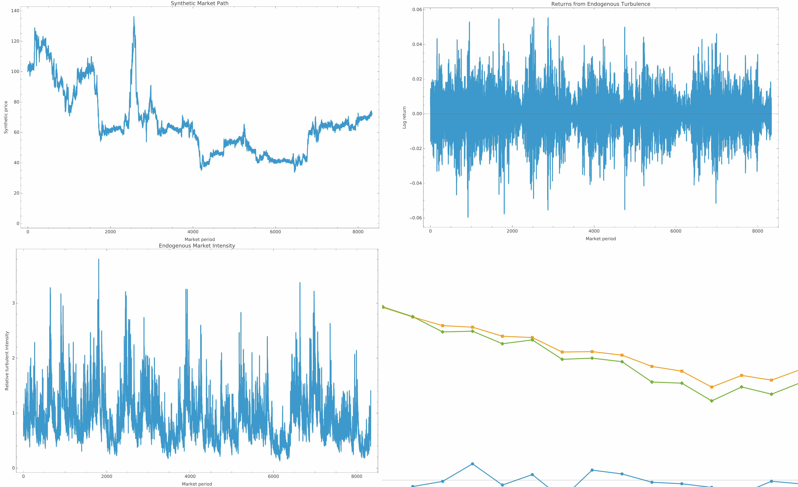
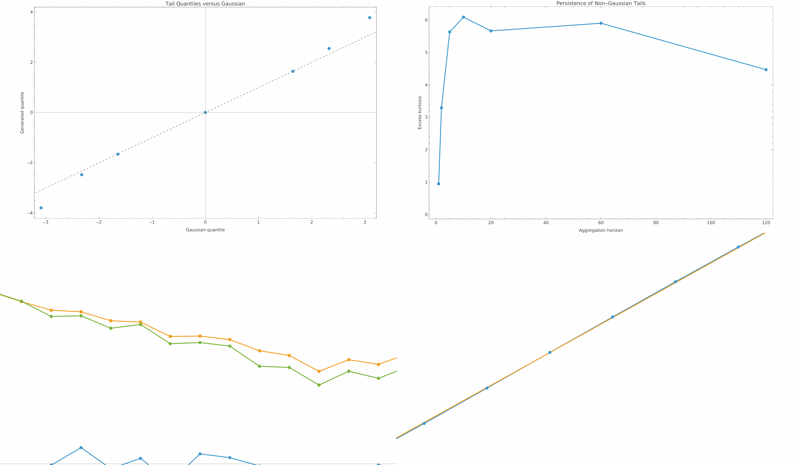

# Documentation

Technical notes for the deterministic one-dimensional turbulence project (Wolfram Language, Mathematica 15.0, no external packages).

**Research question:** can a small deterministic dynamical system produce intermittent, multiscale behavior without prescribing when extreme events occur, how large they are, or how long they last? Financial markets are the first observation domain.



## Architecture

```text
early:  pseudorandom stream -> constructed volatility field -> returns -> prices
final:  seeded shell state -> deterministic nonlinear evolution
        -> interscale transfer + fine-scale dissipation
        -> signed 1D turbulent signal -> thin domain adapter
```

The final core has no event clock, peak indicator, peak-frequency parameter, severity distribution, or threshold-release rule. Randomness only sets the initial state; bursts emerge from the cascade.

## Development stages

| # | Notebook | What it does | Outcome |
| --- | --- | --- | --- |
| 1 | `Untitled-1.nb` | Rule 30 CA → Gaussian variates → persistent dyadic fields → log-volatility → returns/prices. Seed `20260817`, 8,192 obs, 10 levels, intermittency `0.38`, persistence `0.72`, target vol `0.20`. | Fat tails and volatility clustering, but volatility is *constructed*, not generated. |
| 2 | `Verification.nb` | Checks keys/dimensions/positivity, price identities, deterministic regeneration, SHA-256 hashes, moments + Jarque-Bera, tail quantiles, ACFs (raw/abs/squared), aggregation, structure-function scaling. | Verification suite reused for all later stages. |
| 3 | `Working-Turbulence-Model.nb` | Stages `0.1`–`0.6`: Gaussian → peak frequency → peak severity → persistent episodes → linear dissipative cascade → nonlinear state-dependent cascade. Standardized interface (scale states, transfer/dissipation fluxes, activity, conditional scale). | Exact regeneration; activity-budget residual `8.88e-16`. |
| 4 | `Emergence.nb` | Removes explicit peaks: bounded coarse forcing, hysteretic storage/release, four reservoirs, `E^(3/2)` transfer, downstream resistance, scale-dependent dissipation. | Negative result: fixed thresholds + one-way transfer give synchronized relaxation oscillators (sawtooth cycles). Not fixable by tuning. |
| 5 | `Final-Experiment.nb` | Sabra shell cascade, `GenerateSabraTurbulenceV2`. | Irregular intermittency with energy accounting (below). |

## Final model: Sabra shell cascade (`V2`)

- 16 complex shells, `lambda = 2`, base wave number `1/16`
- coefficients `{1, -0.5, -0.5}` (`a + b + c = 0`), viscosity `10^-7`
- constant complex forcing on shell 1, amplitude `0.005`
- seeded random phases/amplitude jitter in the initial state only
- nearest-neighbor triadic nonlinearity; viscous dissipation at fine scales
- integrated injection and dissipation ledgers
- solved with `NDSolveValue` (stiffness switching)
- observable: real part of shell 11, RMS-normalized (mean not removed)

An earlier Sabra run used a stale right-hand side; `V2` definitions were isolated to fix it. Checks: coefficient sum `0`, initial nonlinear energy rate `0`, max sampled nonlinear rate `~1.38e-17`, signal RMS `1`, long-run relative energy-ledger residual `~1.29e-7`.

### Output layers

- **`BuildGeneralTurbulence1D`** — domain-neutral interface: observation times, signed signal, relative intensity, dissipation, metadata.
- **`SabraMarketAdapter`** — converts the signal to log returns and a price path. Annualized volatility is a unit conversion only; no extra stochastic volatility, demeaning, or noise.



## Canonical run

```wl
sabraCoreFinal = GenerateSabraTurbulenceV2[20260817,
    "BurnInTime" -> 2500., "SampleDuration" -> 2500.,
    "SampleInterval" -> 0.03, "MaximumStepSize" -> 0.01];

generalTurbulence1DFinal = BuildGeneralTurbulence1D[sabraCoreFinal,
    "ObservationInterval" -> 0.30];

sabraMarketResultFinal = SabraMarketAdapter[generalTurbulence1DFinal,
    "InitialPrice" -> 100., "AnnualizedLogDrift" -> 0.,
    "AnnualizedVolatilityScale" -> 0.20, "PeriodsPerYear" -> 252.];

sabraVerificationFinal = VerifyTurbulentMarketV2[sabraMarketResultFinal];
```

Results (8,334 observations):

| Metric | Value |
| --- | ---: |
| Annualized volatility | `0.19919` |
| Skewness / excess kurtosis | `0.00801` / `0.95108` |
| Jarque-Bera p-value | `5.93e-69` |
| 0.1% / 99.9% quantile (generated vs Gaussian) | `-3.792` vs `-3.090` / `3.780` vs `3.090` |
| Max abs raw-return ACF, lags 1–20 | `0.06967` |
| Mean abs / squared-return ACF, lags 1–20 | `0.20589` / `0.19634` |
| `zeta(0.5)` / `zeta(5)` | `0.23481` / `2.53827` |
| Quadratic scaling curvature | `-0.000811` |

Heavier-than-Gaussian tails; magnitudes have much more memory than signed returns. Curvature is small, so multifractality is a candidate, not a conclusion.



## Repository map

| Path | Contents |
| --- | --- |
| `Untitled-1.nb` | Rule 30 / dyadic-volatility prototype and export workflow |
| `Verification.nb` | Baseline verification suite |
| `Working-Turbulence-Model.nb` | Stages `0.1`–`0.6` |
| `Emergence.nb` | Forcing, storage/release, reservoir experiments |
| `Final-Experiment.nb` | Sabra `V2` core, 1D layer, market adapter, final verification, figure exports |
| `Baseline/exports/` | Prototype artifacts |
| `exports/nonlinear-cascade-*` | Stage plots, data, state, validation, hashes |
| `exports/endogenous-reservoirs-*` | Reservoir plots, PDFs, manifests |
| `readme-assets/` | Final figures |

`Baseline/Base Build (Market turbulence) .nb` is empty; the baseline lives in `Untitled-1.nb` and the exported `generator-definition.wl`.

## Rerunning

1. Open `Final-Experiment.nb` and evaluate definitions in order (use the `V2` Sabra definitions).
2. Run the canonical block above (5,000 model-time units; slow).
3. Evaluate the export section to regenerate `readme-assets/`.

Export folders can be inspected without Mathematica; JSON and CSV are the most portable.

## Limitations and next steps

- Repeat stationarity and empirical checks over longer windows and multiple seeds.
- Test whether one parameter regime holds across seeds.
- Quantify sensitivity to observation shell and sampling interval.
- Move definitions out of notebook state into package/script files.
- Fix legacy `ReplaceAll::reps` messages in the final verification cell (correct values are recomputed afterwards).
- Add a non-financial observation adapter.

Research prototype only; not a calibrated financial model or trading system.
